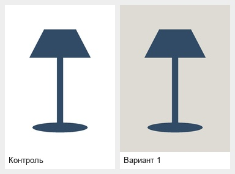

# mp-photo-ab

**Скилл для Codex: варианты главного фото WB/Ozon → план A/B-теста → честный разбор результата.**

Ты даёшь фото реального товара и вводные. Codex помогает сформулировать гипотезы, подготовить варианты и посчитать результат — без обещаний «гарантированно поднять CTR».

Это набор инструкций и локальных Python-скриптов, не отдельный сервис и не бот. В кабинеты маркетплейсов он ничего не загружает.

## Что умеет

1. **Бриф:** категория, артикул, аудитория, УТП, фото и baseline за 14–30 дней. Неизвестные данные спрашивает, а не придумывает.
2. **Гипотезы:** 4–6 вариантов с ICE-оценкой и рисками; в каждой меняется одна переменная. В тест — контроль и 1–2 варианта; для встроенного WB только один.
3. **Изображения:** 2–3 кандидата для выбранной гипотезы через OpenAI image edit по реальному фото. Цвет, форма, логотип и комплектация должны сохраниться — результат обязательно проверяется глазами.
4. **Превью:** две колонки с карточками шириной 180 px, чтобы проверить читаемость как в мобильной выдаче.
5. **План:** выборка и срок по трафику, минимум 7 полных дней, фиксированные цена/реклама/остатки.
6. **Анализ и отчёт:** CSV/XLSX или дневные данные вручную; метрики, интервалы, проверка сплита и история выводов по категории.

**Главная метрика — заказы/показы.** Рост CTR сам по себе не делает фото победителем.

## Установка в Codex

Самый простой способ — отправь Codex:

```text
Установи скилл из https://github.com/ur6an1/mp-photo-ab в мою пользовательскую папку skills.
Прочитай README, подготовь отдельное Python-окружение и проверь тесты.
Платную генерацию не запускай.
```

Ручная установка для macOS/Linux, если папки с таким скиллом ещё нет:

```bash
mkdir -p "$HOME/.agents/skills"
git clone https://github.com/ur6an1/mp-photo-ab.git "$HOME/.agents/skills/mp-photo-ab"
cd "$HOME/.agents/skills/mp-photo-ab"
python3 -m venv .venv
.venv/bin/python -m pip install -r requirements.txt
.venv/bin/python -m unittest discover -s tests -v
```

Нужен **Python 3.11+**. Для превью нужен шрифт с кириллицей: Arial на macOS или DejaVu Sans на Linux. Если каталог уже существует, не удаляй его — попроси Codex проверить установленную версию и обновить её с сохранением твоих файлов.

Скилл размещается в [официальной пользовательской папке Codex](https://developers.openai.com/codex/skills). Если он не появился, перезапусти Codex. Внешние API-ключи для установки, планирования, анализа и dry-run не нужны.

## Первый запуск

В новой беседе с Codex:

```text
$mp-photo-ab
Хочу проверить главное фото карточки на Wildberries.
Помоги собрать бриф и предложить гипотезы. Пока без платной генерации.
```

Подготовь:

- Категорию, артикул, аудиторию, ценовой сегмент и 1–3 подтверждённых УТП.
- Текущее главное фото и **обязательное референс-фото реального товара**.
- По возможности 3–5 скринов конкурентов из выдачи.
- Показы, клики, корзины и заказы за 14–30 дней. Если данных нет, так и скажи.

Рабочие данные хранятся отдельно от скилла: `experiments/<артикул>/<дата>/`. Исходные фотографии, ключи и выгрузки покупателей не нужно загружать в GitHub.

## Бесплатно и платно

**По умолчанию — dry-run:** скилл составляет промпты, но не обращается к Image API и не тратит деньги на изображения.

Платный режим требует твоего явного решения, `--run`, оценки **всей партии**, бюджета, источника и даты оценки. Нужен собственный `OPENAI_API_KEY` в окружении; не отправляй его в чат и не записывай в репозиторий. [API оплачивается отдельно от подписки ChatGPT](https://help.openai.com/en/articles/9039756): не предполагается, что генерации включены в подписку, с которой ты используешь Codex.

Используется OpenAI `gpt-image-1.5` в режиме редактирования по референсам. Адаптера fal в этой версии нет. Локальная проверка оценки не ограничивает фактический биллинг провайдера; после неоднозначного сбоя запрос не повторяется автоматически.

## Как принимается решение

- Метрики: CTR, корзины/клики, заказы/клики и основная заказы/показы.
- Статистика: two-proportion z-test, Wilson 95% CI, Bayesian P(B>A) с Beta(1,1), SRM; поправка на несколько сравнений.
- Недостаточная выборка, нарушенный сплит или изменение условий **не превращаются в победителя**.
- «Разницы нет» означает практическую эквивалентность в заранее выбранных пределах, а не просто `p > 0.05`.
- Первые 3 дня помечаются novelty, но не выкидываются задним числом. Тест не останавливается на первом удобном p-value.
- Последовательное чередование периодов отмечается как менее достоверное и не доказывает причинный эффект фото.

## Демонстрация

Ниже — **синтетический пример проверки превью**, не карточка реального продавца и не результат генерации через API:



[Пример отчёта на вымышленных данных](assets/examples/report.md) показывает формат результата. Указанный в нём uplift демонстрирует расчёт и не является кейсом роста продаж.

## Что важно знать до реального теста

Правила проверялись **29.09.2026**; ссылки и границы проверки — в [требованиях площадок](references/marketplace-image-rules.md).

- **WB:** встроенный A/B — контроль + один вариант; доступ и состав метрик зависят от кабинета. Сначала проверь, доступны ли заказы и показы именно по вариантам.
- **Ozon:** актуальные официальные страницы не удалось прочитать. Правила изображений и доступность встроенного A/B в этой версии **не подтверждены**. Макет нельзя автоматически считать готовым к модерации.
- Для статистического вывода нужны совместимые события и единицы рандомизации. Если кабинет даёт только общие заказы SKU, скилл не распределяет их между вариантами наугад.
- Искажения товара после генерации нужно отбраковывать вручную. Никакая инструкция модели не гарантирует сохранность логотипа и комплектации.
- Платный API не проверялся живым запросом при подготовке этой версии: покрыт mock-тестами. Работа в твоём аккаунте требует отдельного запуска.

## Для тех, кто хочет использовать скрипты напрямую

Команды, форматы JSON/CSV/XLSX и определения метрик: [контракт эксперимента](references/experiment-contract.md). Методика: [статистика](references/statistics.md). Генерация и стоимость: [провайдер](references/image-providers.md).

```bash
.venv/bin/python scripts/experiment.py --help
.venv/bin/python scripts/generate.py --help
.venv/bin/python scripts/thumbnail_preview.py --help
```

В `assets/samples/` лежат учебный бриф и дневные метрики. Пути фото в sample-брифе нужно заменить на свои; готовый бриф реального товара там не зашит.

## Проверки

```bash
.venv/bin/python -m unittest discover -s tests -v
```

Тесты проверяют расчёты, CSV/XLSX, ошибочные данные, полный локальный сценарий, отсутствие API-вызовов в dry-run и запрет автоматического повтора платной партии. Они не тратят деньги на Image API. Проверка структуры скилла выполняется отдельно через `quick_validate.py` из установленного `skill-creator`.
